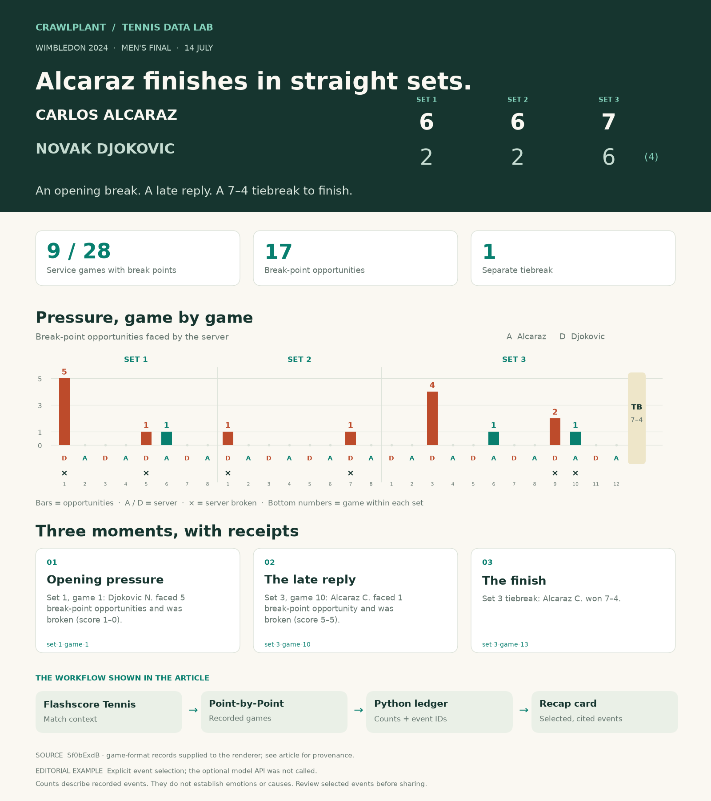

# An illustrated match recap



## Run

From the repository root, after installing `tennis/requirements.txt`:

```sh
python tennis/render_recap.py
```

Output: [PNG](../assets/13-illustrated-recap.png) / [SVG](../assets/13-illustrated-recap.svg).

Actors used in the live workflow: [tennis-point-by-point](https://apify.com/crawlplant/tennis-point-by-point).

[Full tutorial and live input examples](https://crawlplant.com/guides/ai-match-recap/).

The default run uses dated saved data and makes no network calls. AI selections are editorial demonstrations; no model response is claimed. See [data provenance and limitations](../README.md).
