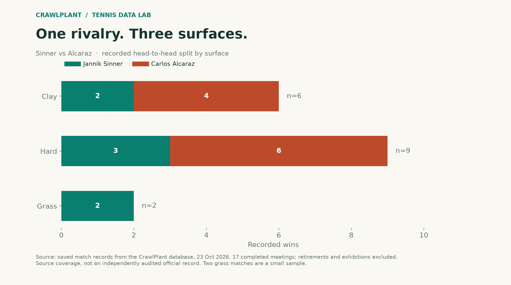

# A rivalry across three surfaces



## Run

From the repository root, after installing `tennis/requirements.txt`:

```sh
python tennis/render.py
```

The shared renderer rebuilds all tennis charts and reports in one run.

Output: [PNG](../assets/02-rivalry-surfaces.png) / [SVG](../assets/02-rivalry-surfaces.svg).

Inspect the [result](../reports/rivalry.md).

Actors used in the live workflow: [tennis-match-history](https://apify.com/crawlplant/tennis-match-history).

[Full tutorial and live input examples](https://crawlplant.com/guides/rivalry-on-three-surfaces/).

The default run uses dated saved data and makes no network calls. AI selections are editorial demonstrations; no model response is claimed. See [data provenance and limitations](../README.md).
